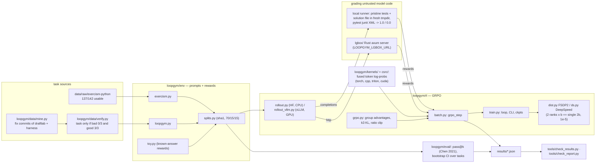

# loopgym

RL post-training (GRPO) of a small coding model on tasks made from bugs that autonomous coding agents actually
shipped, plus the systems around it: a Rust sandbox server for grading, a fused log-prob kernel (C++/CUDA/Triton),
FSDP2 / DeepSpeed training checked against single-process math, vLLM rollouts, and host / AWS scripts for GPU runs.
Built by local agents from TODO.md; see CLAUDE.md for the rules and the known answers every number is checked against.

## Architecture



## Quickstart

```bash
make bootstrap                      # .venv + pinned cargo/rustup in .tools
export OMP_NUM_THREADS=8            # CPU is shared with other agents

make known                          # Kevin's known-answer tests (read-only)
make check                          # ruff + pytest tests/ + cargo test + lints

# Toy controls (run before any real GRPO): planted effect must learn, null must not
.venv/bin/python -m loopgym.rl.train --config configs/toy_banana.toml
.venv/bin/python -m loopgym.rl.train --config configs/toy_null.toml
.venv/bin/python tools/toy_check.py --dir runs

# Train: 0.5B CPU, LoRA, exercism train split (--dry-run prints the plan)
.venv/bin/python -m loopgym.rl.train --config configs/grpo05_exercism.toml

# Eval: pass@1, T=0.8, CI over tasks (add --adapter <dir> after training)
.venv/bin/python -m loopgym.eval.run \
  --model models/qwen2.5-coder-0.5b-instruct --source exercism --split val --n 4

# Grading server smoke: build lgbox, serve, known reward tests over http
bash tools/lgbox_smoke.sh

# Benches (small cells; full runs are compute jobs, see TODO.md run: lines)
.venv/bin/python tools/bench_lgbox.py --quick
.venv/bin/python tools/bench_logprob.py --quick

# Mine -> verify a loopgym candidate (prints pass/fail verdict, appends results/verify.jsonl)
.venv/bin/python -m loopgym.data.mine
.venv/bin/python -m loopgym.data.verify <candidate-id>

# Recompute every number the report and results carry
.venv/bin/python tools/check_results.py
.venv/bin/python tools/check_report.py
```

GPU runs are host-only (Kevin): `bash scripts/gpu_run.sh --dry-run` prints the plan; the real window runs
CUDA/Triton known tests, the vLLM-vs-HF gate, the 1.5B GRPO run and the scale rehearsals.

## Skills map

| skill | files |
|---|---|
| GRPO / RL | `loopgym/rl/grpo.py`, `loopgym/rl/batch.py`, `loopgym/rl/rollout.py`, `loopgym/rl/train.py`, `configs/*.toml` |
| PyTorch FSDP2 | `loopgym/rl/dist.py`, `loopgym/rl/launch.py`, `tests/test_train_dist.py`, `tests/test_launch_cmds.py` |
| DeepSpeed | `loopgym/rl/ds.py`, `configs/ds_zero3.json`, `configs/scale05.toml` |
| vLLM | `loopgym/rl/rollout_vllm.py`, `loopgym/rl/check_vllm_hf.py`, `scripts/gpu_run.sh` |
| C++ / CUDA / Triton | `loopgym/kernels/` (`__init__.py`, `triton_logprob.py`, `cuda_ext.py`), `csrc/logprob_cpu.cpp`, `csrc/logprob_cuda*.cu`, `tools/bench_logprob.py` |
| Rust | `lgbox/` (axum sandbox server: `src/`, `tests/`), `tools/lgbox_smoke.sh` |
| AWS / Terraform | `deploy/aws/terraform/*.tf`, `deploy/aws/iam/`, `scripts/aws_launch.sh`, `scripts/aws_sweep.sh` |
| Docker | `deploy/docker/lgbox.Dockerfile`, `deploy/docker/trainer.Dockerfile` |
| Eval / stats | `loopgym/eval/run.py`, `loopgym/eval/passk.py`, `loopgym/eval/stats.py` |
| Mining / verification | `loopgym/data/mine.py`, `loopgym/data/verify.py`, `data/loopgym/v0/` |
| Checks / reports | `tools/check_results.py`, `tools/check_report.py`, `tools/check_known.sh` |
